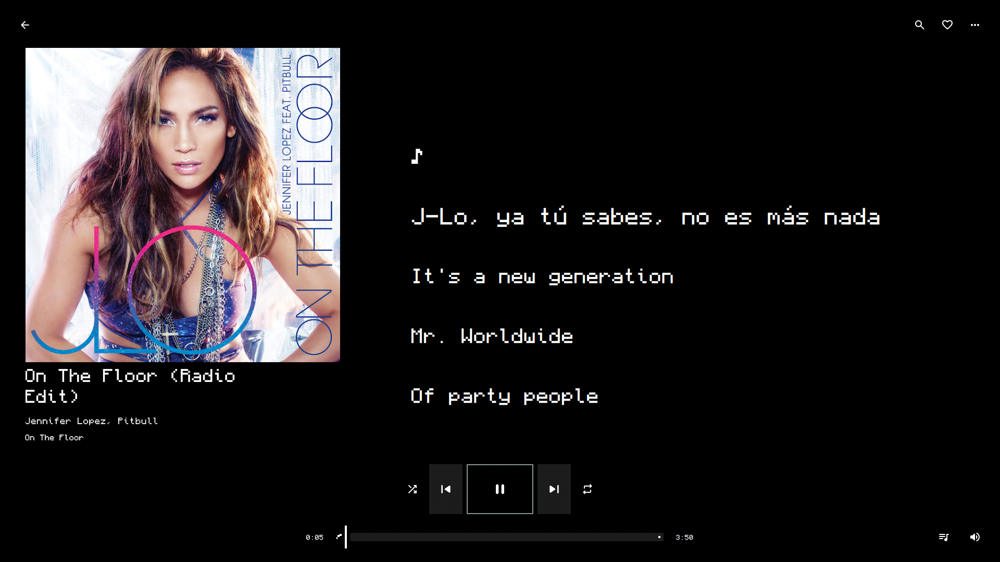

<div align="center">



# Noir

A native Linux player for YouTube Music, your music files and your music server.
Pixel art on black, built with Qt 6 Quick.

[](LICENSE)


</div>

## Install

Noir is written for CachyOS and Wayland. Install the build tools and Qt:

```bash
sudo pacman -S --needed git base-devel cmake ninja python nodejs ffmpeg qt6-base qt6-declarative qt6-multimedia qt6-svg qt6-wayland qt6-imageformats
```

The whole interface is set in [Monocraft](https://github.com/IdreesInc/Monocraft). Install it before you start Noir. There is no fallback font, so a missing Monocraft shows up as a different-looking app rather than an error.

Then clone and install:

```bash
git clone https://github.com/jfreddin/noir.git
cd noir
./scripts/install.sh
```

The install goes to `~/.local`. Run it as your own user, not with `sudo`. Open **Noir** from your application menu, or run `noir`.

Other distributions need Qt 6.8 or newer (Core, Concurrent, Gui, Quick, Qml, QuickControls2, Multimedia, Network, DBus, Svg and Wayland), a C++20 compiler, CMake 3.24 or newer, Ninja, Python 3 with `venv` and `pip`, Node.js (yt-dlp uses it to solve YouTube's challenges) and FFmpeg.

## Sources

- **YouTube Music**: search and play songs, albums, artists and playlists. Browsing is anonymous. Likes, playlists and history stay on this machine.
- **Your files**: add FLAC, MP3 and other audio, or whole folders. Folders rescan while Noir runs.
- **Subsonic, Navidrome and Jellyfin**: browse and play from your server, with ratings and playlist edits where the server allows them.
- **Apple Music through Cider**: plays Apple Music through [Cider](https://cider.sh), which needs its own copy and your subscription.

Synchronized lyrics, animated covers, an ambient backdrop behind the player, and a pickable accent colour are built in.

## Controller

Connect a PlayStation or Xbox controller over USB or Bluetooth. Turn on **Settings → Controller guide** to show each button's label under the control it works.

| Input | Action |
| --- | --- |
| Left stick | Move the focus ring. Hold to keep moving. |
| Right stick | Scroll the list or page under the ring |
| A (Cross) | Press the focused control |
| B (Circle) | Back: leave a list, close a menu or dialog, close the pinned panel |
| Y (Triangle) | Open the menu of the highlighted queue or history row; otherwise show or hide Now Playing |
| X (Square) | Play or pause |
| D-pad left / right | Previous / next |
| D-pad up / down | Volume |
| L1 / R1 | Home / Search |
| L2 / R2 | Previous / next library tab |
| Select (Share) | Pinned playlists |
| Start (Options) | Settings |
| Left stick click | Repeat |
| Right stick click | Shuffle |

Inside a list, the stick steps through rows and scrolls them. O leaves the list and returns the focus to the control you came from.

## Keyboard

| Key | Action |
| --- | --- |
| Space | Play or pause |
| Ctrl+Right / Ctrl+Left | Next / previous song |
| Right / Left | Seek 10 seconds |
| Ctrl+Up / Ctrl+Down | Volume |
| Ctrl+F or Ctrl+K | Search |
| Ctrl+L | Queue |
| Ctrl+J | Show the playing song in the queue |
| Ctrl+M | Mini player |
| Ctrl+Shift+P | Quick actions |
| ? or F1 | Shortcut reference |

## Music servers

Open **Settings → Connections → Music server**. Choose Subsonic (Navidrome works too) or Jellyfin, then enter the server address, your username and password. Use the server root, without `/rest` or `/web`. Use HTTPS for any server you reach over the internet.

For Apple Music, open Cider's **Settings → Connectivity → Manage External Application Access**, create a token, then choose Cider in Noir's music server settings and paste it. Cider has to stay open. Noir sends it one song at a time, so the queue and lyrics are Noir's.

## Data

Library data is kept in `~/.local/share/Noir`, settings in `~/.config/Noir`, and cache in `~/.cache/Noir`.

## Development

```bash
./scripts/setup.sh    # Python environment for the helper
./scripts/build.sh    # build the app
./scripts/run.sh      # run it from the build directory
./scripts/test.sh     # unit and Python tests
./scripts/verify.sh --offline   # every stage, with screenshots
```

The scripts use Ninja. The full verification run takes twenty to thirty minutes.

## License

[MIT](LICENSE). Material Symbols are Apache-2.0; see [NOTICE](NOTICE). Noir is not affiliated with Google or YouTube.

Noir began as a fork of [Sung](https://github.com/yappologistic/Sung).
